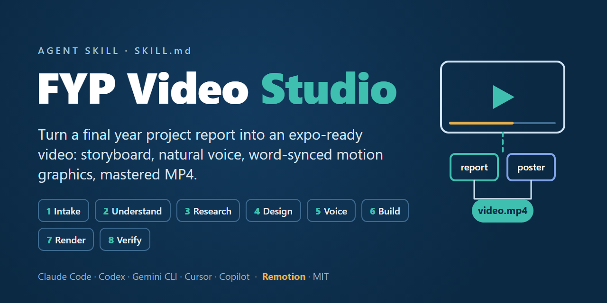
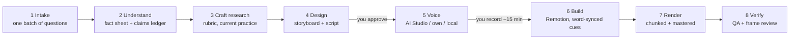

<div align="center">



# FYP Video Studio

**An Agent Skill that turns your Final Year Project report into an award-quality expo, demo or pitch video.**

Works with Claude Code, Codex, Gemini CLI, Cursor and GitHub Copilot through the open [Agent Skills](https://agentskills.io) (`SKILL.md`) standard.

[](LICENSE)
[](https://agentskills.io)
[](https://www.remotion.dev)
[](#results)

[Install](#install) · [How it works](#how-it-works) · [What it asks you](#what-it-asks-you) · [Results](#results) · [FAQ](#faq)

</div>

---

You hand over your **report, poster or slides**. The skill interviews you once, studies your project and its field, writes a storyboard in your poster's own style, gets you a natural narrator voice for free, animates your real diagrams with every motion landing on its spoken word, and checks the finished MP4 before you see it.

**For:** final year projects (FYP / FYDP), capstone and senior-design projects, thesis and defense videos, design expos, demo days and university project showcases, in any engineering or computing field.

## What you get

| Video | Length | Use |
|---|---|---|
| **Expo pitch** | 2–3 min | Main submission and the QR code on your poster |
| **Booth loop** | 60–90 s | Plays on a screen at your stand; readable with the sound off |
| **Demo video** | 3–6 min | Real footage of the working project plus explanatory graphics |
| **Presentation video** | 6–15 min | Narrated walkthrough that replaces a live talk |
| **Teaser** | 30–60 s | Social media or opening slide |

Each comes as captioned and clean 1080p MP4s (H.264, BT.709, −16 LUFS), `.srt` captions, and the editable source project.

## Install

**Claude Code: plugin (recommended)**
```text
/plugin marketplace add M-Umar-khawaja/fyp-video-skill
/plugin install fyp-video-studio@fyp-video-skill
```

**Claude Code, Codex, Gemini CLI, Cursor or Copilot: skills CLI**
```bash
npx skills add M-Umar-khawaja/fyp-video-skill
```

**Manual copy (any agent that reads `SKILL.md`)**
```bash
git clone https://github.com/M-Umar-khawaja/fyp-video-skill.git
cp -r fyp-video-skill/skills/creating-fyp-videos ~/.claude/skills/     # Claude Code
cp -r fyp-video-skill/skills/creating-fyp-videos ~/.agents/skills/     # Codex and others
```

**Claude apps (claude.ai, desktop):** download `creating-fyp-videos.zip` from [Releases](../../releases) and add it under *Settings → Capabilities → Skills*. Rendering needs a code-execution environment with Node.js, so Claude Code on your own computer is the smoothest option.

Then just ask:
> Here's our FYP report and poster. Make us a 3-minute video for the design expo.

## How it works



| Phase | The skill does | You do |
|---|---|---|
| **1 Intake** | Reads what you sent, detects your domain, asks once for only what's missing | Answer one message, attach files |
| **2 Understand** | Reads every file, researches the field, writes a fact sheet, a **claims ledger** and a pronunciation glossary | Confirm anything contradictory |
| **3 Craft research** | Finds your event's rubric and length limit; checks current motion-design and Remotion practice | — |
| **4 Design** | Concept, visual system from your poster, storyboard with 3–5 "applause moments", script at 140–150 wpm, self-critique against a judge's rubric | **Approve the design** |
| **5 Voice** | A copy-paste sheet for Google AI Studio (free, natural), tips for your own voice, or local TTS; then checks every take word for word | **Generate the takes** |
| **6 Build** | Remotion project; your real diagrams redrawn as vectors; every cue anchored to a spoken phrase; repeated still-frame review | — |
| **7 Render** | Chunked, resumable rendering that survives an 8 GB laptop; loudness and colour mastering | — |
| **8 Verify** | Automated QA (frames, sync, loudness, captions) plus inspection of frames from the final file | Listen once |

## What it asks you

One batched message, essentials first. It never asks for something you already gave it:

1. Which video, the **length limit and official rubric**, and the deadline
2. Your project's **stage**: what is built, simulated or measured, and what is only planned
3. **Domain-specific material** that's missing, for example prototype photos and schematics (IoT), RTL spec and synthesis reports (VLSI), screen recordings (software), or dataset, baselines and confusion matrices (AI/ML)
4. Team, supervisor, institution and partner names and logos

Built-in guidance covers **VLSI/FPGA, embedded/IoT, software/web/mobile, AI/ML, networking/security/cryptography, robotics, power/electrical, communications/DSP, mechanical/civil, biomedical and business-tech**.

## Why the videos hold up in front of judges

- **Honest by construction.** Every number on screen comes from your documents and is labelled *measured*, *simulated*, *target* or *planned*. The wording follows the label ("achieves" vs "targets" vs "will"), so the video never promises more than you can defend in Q&A.
- **Your identity, not a template.** Colours, fonts and diagram style come from your poster. No glowing circuit boards, stock 3D chips or "AI slideshow" look.
- **Motion that explains.** One idea per spoken phrase, data moving along your real wires, a camera flying through your architecture, and holds after each payoff.
- **Picture locked to the voice.** Local speech-to-text (whisper.cpp) timestamps every word, and animation cues anchor to phrases. Re-record a line and everything re-aligns.
- **Readable everywhere.** Projector and phone-sized labels, sentence captions, and a muted-first design for booth loops.

## Results

**Tested end to end.** The bundled template renders and masters a video that passes automated QA (600/600 frames, −16 LUFS, −1.5 dBTP). On real Gemini TTS takes, the timeline builder placed every scene within 0.05 s of a hand-timed version, and recovered automatically when speech-to-text misheard the project name.

**Evaluated against a no-skill baseline** on three realistic student requests (IoT intake, an ML pitch plan, voice guidance), using the same model:

| | Checks passed |
|---|---|
| With this skill | **18 / 18 (100 %)** |
| Without the skill | 14 / 18 (77.5 % mean) |

The skill consistently added what the baseline missed: domain classification, a written brief, a claims ledger, named visual payoff moments, and a free natural-voice recommendation. The test cases are in [`skills/creating-fyp-videos/evals`](skills/creating-fyp-videos/evals) and run with `claude plugin eval`.

It was distilled from a real design-expo build: a 2:55 pitch and a 1:16 booth loop for a post-quantum cryptography accelerator.

## Under the hood

| Part | Technology |
|---|---|
| Animation | [Remotion](https://www.remotion.dev) 4 (React + SVG), frame-accurate |
| Word timing | whisper.cpp via `@remotion/install-whisper-cpp`, run locally |
| Voice | Google AI Studio Gemini TTS (free), your own recording, or local TTS |
| Music and sound effects | Synthesised locally in Python (numpy), so nothing to license |
| Mastering | ffmpeg two-pass EBU R128 loudness, BT.709 limited range |
| QA | Frame count, sync, loudness, true peak, black/frozen-frame and caption checks |

Requirements: Node.js 18+, Python 3 with numpy, about 1.5 GB of free disk (4 GB comfortable), and internet on the first run.

## FAQ

**Can it make a capstone or senior-design video, not just an "FYP" one?** Yes. FYP, FYDP, capstone, senior design, thesis demo and project showcase all describe the same thing to the skill.

**Do I need to know Remotion, React or video editing?** No. The agent writes and renders everything; you approve the design and record (or generate) the voice.

**Will the voice sound robotic?** Not with the recommended path: Google AI Studio's Gemini TTS is free and natural, and the skill gives you a click-by-click sheet with pronunciation spellings. Local TTS is offered as a no-effort fallback, labelled honestly as more synthetic.

**My project isn't finished. Can I still make a video?** Yes, and this is where the skill helps most: targets and plans are shown and narrated as targets and plans.

**Can I use my own screen recordings or prototype footage?** Yes. Demo videos combine your footage with callouts and explanatory graphics.

**Non-English narration?** Yes. Gemini TTS covers 100+ languages, and transcription supports a `--language` option.

**Will it run on my laptop?** It was built and tested on an 8 GB RAM Windows laptop with under 2 GB of free disk, using the chunked render path.

## Repository layout

```
skills/creating-fyp-videos/
├── SKILL.md            8-phase workflow, approval gates, principles
├── references/         intake, domains, research, storytelling, visual design,
│                       voice, Remotion build, verification, troubleshooting
├── scripts/            check_env · init_project · transcribe · build_timeline ·
│                       audio_tools.py · stills · render · master · qa
├── assets/             Remotion starter template, spec example, storyboard and voice-sheet templates
└── evals/              test cases (claude plugin eval)
.claude-plugin/         Claude Code plugin + marketplace manifests
```

## Contributing

Issues and pull requests are welcome, especially domain playbooks for fields not yet covered, scene examples, and reports from real expo runs (what judges said). Please keep every claim in the skill verifiable.

## License

MIT. See [LICENSE](LICENSE). Remotion has its own [license](https://www.remotion.dev/license): free for individuals and small teams. Gemini TTS audio carries Google's SynthID watermark; the skill credits it on the end card.
